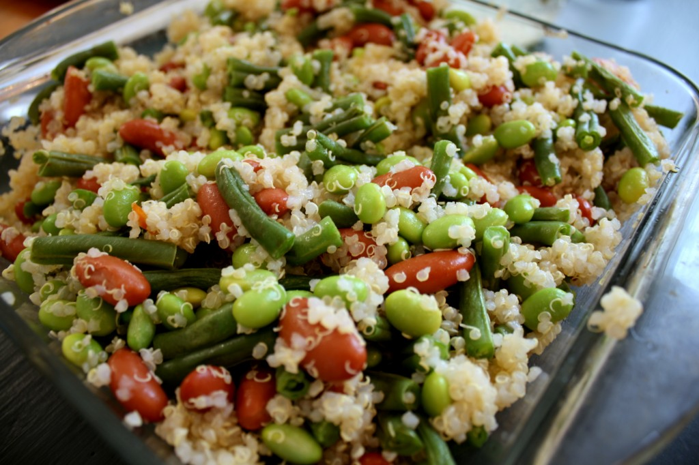

aka Priya and Andrew's Visit (2/3)

If there's one thing I love, it's cheap, tasty food. Thankfully, Cleveland seems to be full of it. One of the great lesser known "cheap, tasty food treasures" is <a href="http://cleveland.metromix.com/events/dining_event/5x7-food-and-wine-university-heights/889676/content">Whole Foods' 5 X 7</a>. Basically, every Friday from 5pm to 7pm you can show up at Whole Foods, and for $5 ($4 if you bring back your old wine glass) you can sample delicious wine and food pairings. If you happen to be driving, you can choose to eat 2 helpings of each food sample and forgo the alcohol. It's a fun thing to do when you're bored, don't feel like cooking, or just happened to have finished a particularly difficult anatomy exam. What's even better is after you find a dish that you're particularly fond of, you can go home and find the recipe on their website...and that's exactly how we came up with the next green themed item served during Priya and Andrew's visit.

[caption id="" align="alignnone" width="640" caption="Photo taken by Michael Cover"][/caption]

Since this isn't a recipe we came up with ourselves, we will share pictures, but rather than posting the recipe, we will direct you to <a href="http://www.wholefoodsmarket.com/recipes/2553">Whole Foods website</a>. We will, however, note the few differences in our dish versus the original recipe...

First of all, we didn't add the salt or pepper...now I'm gonna claim that I was trying to be more health conscious, but in reality, I just forgot to add it. Next, we didn't have easy access to roasted red peppers or dried tarragon, so we didn't add those either. Finally, while I understand that Whole Foods is gonna try to promote their own products on their website, it is not necessary to purchase the "brand name" items. We bought shelled edamame at <a href="http://www.yelp.com/biz/tink-holl-cleveland">Tink Holl</a> (my favorite asian grocery store in cleveland!!), and generic kidney beans and italian dressing at Dave's Market. Despite all these changes, the dish still turned out absolutely delicious, and we plan to make it again in the future!

